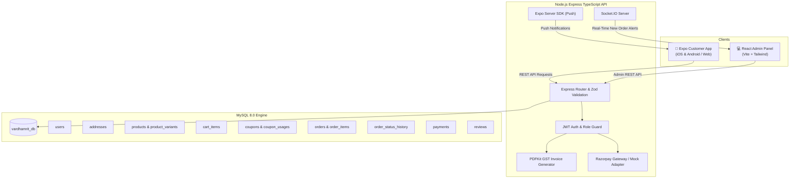

# 🍵 Vardhamrit — Production-Ready Chai E-Commerce Platform

Vardhamrit is a full-stack, enterprise-grade e-commerce system built specifically for artisanal Indian tea leaves ("Chai Patti"). It comprises:
1. **Expo (React Native) Customer Mobile App**: TypeScript, Expo Router, React Query, SecureStore, Expo Notifications, and Razorpay checkout.
2. **Node.js + Express REST Backend**: TypeScript, raw `mysql2` connection pooling with row-level transaction locking (`FOR UPDATE`), Zod validation, JWT authentication, PDFKit GST invoice generation, Socket.IO real-time event streaming, and Expo Push Notifications.
3. **React Web Admin Panel**: Vite + React, TypeScript, Tailwind CSS, Recharts analytics, real-time audio/toast order alerts via Socket.IO, and CSV export.

---

## 🏛️ System Architecture



---

## 🚀 Quick Start Guide

### 1. Prerequisites
- **Node.js**: v18.x or v20.x+ (v22.14 verified)
- **MySQL**: 8.0+ running locally or via Docker
- **npm** or **pnpm** / **yarn**

### 2. Database Migration & Seed Data
From the backend directory:
```bash
cd backend

# Copy environment configuration
cp .env.example .env

# Run database migrations (idempotent, recorded in migrations_meta)
npm run migrate

# Seed catalog, test admin, customer, addresses, and sample reviews
npm run seed
```

### 3. Running All Services

#### Backend API (Port 5000)
```bash
cd backend
npm run dev
# Server running at http://localhost:5000
# Health check at http://localhost:5000/health
```

#### Admin Web Panel (Port 5173)
```bash
cd admin
npm run dev
# Admin portal running at http://localhost:5173
```

#### Customer Mobile App (Expo)
```bash
cd app
npx expo start
# Press 'w' for Web, 'a' for Android emulator, or 'i' for iOS simulator
```

---

## 🔑 Pre-Seeded Credentials

| Role | Email / Phone | Password | Capabilities |
| :--- | :--- | :--- | :--- |
| **Super Admin** | `admin@vardhamrit.com` | `Admin@123` | Dashboard analytics, order approval/rejection/dispatch, invoices, product CRUD, coupon management, review moderation |
| **Customer** | `customer@vardhamrit.com` or `+919876543210` | `Customer@123` | Browse catalog, database cart, checkout (Razorpay/COD), order history, invoice download, verified reviews |

---

## 🔒 Razorpay Payment Security & Integration

### Payment Lifecycle
1. **Server-Side Order Creation (`POST /payments/create-order`)**:
   - The server computes the payable amount in **paise** (`Math.round(order.total * 100)`).
   - Generates a Razorpay Order ID and returns it with `key_id`.
2. **Signature Verification (`POST /payments/verify`)**:
   - Client returns `razorpay_order_id`, `razorpay_payment_id`, and `razorpay_signature`.
   - The server verifies constant-time HMAC SHA256:
     ```ts
     crypto.createHmac('sha256', secret).update(`${order_id}|${payment_id}`).digest('hex');
     ```
   - Only on a matching signature is payment recorded as `PAID` and order confirmed.
3. **Webhook Verification (`POST /payments/webhook`)**:
   - Signature verified via `x-razorpay-signature`.
   - Handles `payment.captured`, `payment.failed`, and `refund.processed` with idempotency safeguards.
4. **Automated Refunds**:
   - When an online paid order is cancelled by the customer or rejected by the admin, the backend automatically calls `processRefund()` to initiate an automated refund via the Razorpay API.
5. **Local Test / Mock Mode**:
   - Setting `MOCK_PAYMENT_GATEWAY=true` in `backend/.env` enables complete testing of payment verification, webhooks, and refunds without active Razorpay API credentials.

### Checklist for Going Live
- [ ] Set `MOCK_PAYMENT_GATEWAY=false` in `backend/.env`.
- [ ] Supply live Razorpay API keys (`RAZORPAY_KEY_ID=rzp_live_...` and `RAZORPAY_KEY_SECRET`).
- [ ] Set up the Razorpay Webhook in the Razorpay Dashboard pointing to `https://api.yourdomain.com/payments/webhook` with events `payment.captured` and `payment.failed`.
- [ ] Enter `RAZORPAY_WEBHOOK_SECRET` in `.env`.
- [ ] For Expo native standalone builds: build using EAS (`eas build --profile production`) with the `react-native-razorpay` config plugin.

---

## 📄 GST Invoice PDF Generation

Every approved order automatically generates a compliant GST Tax Invoice:
- **Seller**: Legal name, address, GSTIN (`19AAACV1234F1Z5`), email, phone.
- **Buyer**: Billing and shipping address snapshot.
- **Itemized Table**: Product name, variant pack size (250g, 500g, 1kg), unit rate, quantity, line totals.
- **Tax Breakdown**: CGST (2.5%) + SGST (2.5%) on discounted taxable amount, delivery fee, grand total.
- **Endpoints**:
  - `GET /orders/:id/invoice` (Customer)
  - `GET /admin/orders/:id/invoice` (Admin)
- Streamed inline as `application/pdf` and shareable on mobile via `expo-sharing`.

---

## 📬 Postman Collection & API Docs

Import the included file:
```text
/var/www/html/vardhamrit/vardhamrit_postman_collection.json
```
Into Postman, Insomnia, or Bruno to immediately test all authenticated and public endpoints.

---

## 🐳 Docker & Production Deployment

### Docker Compose
Run the containerized stack:
```bash
docker compose up -d
```

### Nginx Reverse Proxy Configuration
```nginx
server {
    listen 80;
    server_name api.vardhamrit.com;

    location / {
        proxy_pass http://localhost:5000;
        proxy_http_version 1.1;
        proxy_set_header Upgrade $http_upgrade;
        proxy_set_header Connection 'upgrade';
        proxy_set_header Host $host;
        proxy_cache_bypass $http_upgrade;
    }
}
```

---

## 🧪 Automated Test Suites

Run all backend integration test suites:
```bash
cd backend
npm test
```
The test runner executes:
- **Phase 2**: Auth registration, login, token refresh, catalog, database cart, address CRUD.
- **Phase 3**: Coupon engine validation, atomic stock decrementing checkout, status lifecycle, cancellation restock.
- **Phase 4**: Razorpay order generation, anti-tamper signature blocking, verified capture, webhook idempotency, auto-refund.
- **Phase 5**: PDFKit invoice generation, binary PDF streaming check, review moderation, CSV export, customer metrics.
